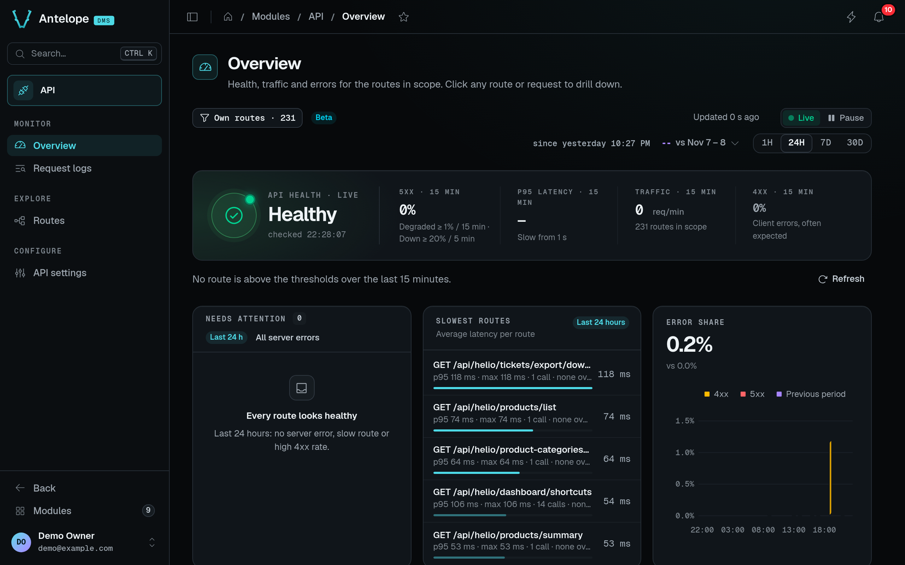

<a href="https://github.com/AntelopeJS/dms"></a>

<div align="center">

# `@antelopejs/dms-api`

<a href="https://www.npmjs.com/package/@antelopejs/dms-api"></a> <a href="./LICENSE"></a> <a href="https://discord.gg/g4pFt6eXqu"></a> <a href="https://dms.antelopejs.com/docs/modules/api"></a> <a href="https://github.com/AntelopeJS/dms"></a>

**See whether your API is healthy, which routes fail or slow down and why, and test any route from the dashboard.**

[Try it in the live demo](https://dms-demo.antelopejs.com/modules/api) · [Documentation](https://dms.antelopejs.com/docs/modules/api) · [All modules](https://github.com/AntelopeJS/dms#modules)

</div>



## What it does

- Tells whether your API is healthy, since when and why not, with traffic, errors and the slowest routes.
- Captures every request of your project's routes with its error, timing, headers and bodies (size-capped and redacted).
- Lists every registered route with its statistics and a contract inferred from code and traffic.
- Sends test requests from a built-in tester, logged apart from real traffic.
- Applies its settings (watched routes, retention, captured headers, slow threshold) without a restart.

It is the dashboard for your API, not the HTTP server: the project still needs an API provider such as `@antelopejs/api`.

## Install

Run the AntelopeJS CLI from the root of a project that already loads `@antelopejs/dms`:

```bash
ajs project modules add @antelopejs/dms-api
```

## Quick start

The module works without configuration. Restart the backend, then the frontend, and open **Modules → API** (`/modules/api`). Review the [configuration](https://dms.antelopejs.com/docs/modules/api/configuration) before capturing real traffic: request logs can hold application data.

To try it with sample traffic, clone this repository and run its playground:

```bash
pnpm install && pnpm dev          # backend
pnpm frontend:dev                 # dashboard, in a second terminal
pnpm --dir playground traffic     # a few hundred demo requests
```

[template-dms-demo](https://github.com/AntelopeJS/template-dms-demo) also loads the module.

## Compatibility

<!-- antelopejs-docs-compat:start -->

| Package                                     | Supported          | Tested with |
| ------------------------------------------- | ------------------ | ----------- |
| `@antelopejs/interface-api`                 | `>=0.2.0 <0.3.0`   | `0.2.0`     |
| `@antelopejs/interface-api-util`            | `>=0.3.0 <0.4.0`   | `0.3.0`     |
| `@antelopejs/interface-core`                | `>=0.4.0 <0.5.0`   | `0.4.0`     |
| `@antelopejs/interface-database`            | `>=0.3.0 <0.4.0`   | `0.3.0`     |
| `@antelopejs/interface-database-decorators` | `>=0.2.0 <0.3.0`   | `0.2.0`     |
| `@antelopejs/interface-dms`                 | `>=0.12.0 <0.13.0` | `0.12.0`    |
| `@antelopejs/interface-dms-automation`      | `>=0.6.0 <0.7.0`   | `0.6.0`     |

<!-- antelopejs-docs-compat:end -->

The module also needs a DMS backend in a release that implements the `@antelopejs/interface-dms` range above, and the `@antelopejs/dms-frontend` renderer in the range its frontend module declares in `engines["@antelopejs/dms-frontend"]` of `frontend-vue/package.json`; the `ajs dms` CLI refuses to build it with a renderer outside that range. It runs on these providers:

- API provider: `@antelopejs/api`.
- Database: an `@antelopejs/interface-database` implementation, such as `@antelopejs/mongodb`.

Upgrading from 0.1? Read the [FAQ](https://dms.antelopejs.com/docs/modules/api/faq#upgrading-from-01).

## Documentation

- [Introduction](https://dms.antelopejs.com/docs/modules/api/introduction)
- [Installation](https://dms.antelopejs.com/docs/modules/api/installation)
- [Configuration](https://dms.antelopejs.com/docs/modules/api/configuration)
- [Usage](https://dms.antelopejs.com/docs/modules/api/usage/overview)
- [Extending](https://dms.antelopejs.com/docs/modules/api/extending)
- [FAQ](https://dms.antelopejs.com/docs/modules/api/faq)

The guide's sources live in [`docs/`](./docs). The package also ships the `dms-api` Claude Code skill in [`skills/`](./skills), declared under `antelopeJs.skills`.

## Contributing

Read [CONTRIBUTING.md](./CONTRIBUTING.md) before opening a pull request. Use the pnpm version declared in `package.json`. The playground connects to MongoDB at `mongodb://localhost:27017` unless `MONGO_URL` points elsewhere.

One root install includes the backend and shipped Vue module, retaining their separate lockfiles. The playground remains independent: run `pnpm --dir playground install --ignore-workspace --frozen-lockfile` before starting it. Use the root scripts below rather than recursive scripts: frontend `build` and `typecheck` need the playground or a generated Inertia workspace, and root checks already delegate to the Vue module.

```bash
pnpm install
pnpm dev            # playground backend
pnpm frontend:dev   # dashboard, in a second terminal
pnpm lint
pnpm typecheck
pnpm test           # backend unit tests (tests/), then the frontend suite
pnpm knip
```

<details>
<summary>Repository notes</summary>

- To build and typecheck the frontend module against the installed DMS, run `pnpm exec ajs dms verify-source -m ../frontend-vue` from `playground/`, or set `DMS_FRONTEND_WORKSPACE` to the workspace generated by `ajs dms prepare` and run `pnpm --dir frontend-vue typecheck`.

</details>

## Part of AntelopeJS DMS

This module installs into [AntelopeJS DMS](https://github.com/AntelopeJS/dms), the open-source back office. Every module adds its pages to the same dashboard, behind the same sign-in and roles.

<!-- antelopejs-dms-modules:start -->

| Module                                                           | What it adds                                                                             |
| ---------------------------------------------------------------- | ---------------------------------------------------------------------------------------- |
| [`dms-builder`](https://github.com/AntelopeJS/dms-builder)       | Edit pages, tables and data sources by clicking, as TypeScript that compiles             |
| [`dms-ai`](https://github.com/AntelopeJS/dms-ai)                 | An assistant chat in the dashboard, on your own Claude Code or Codex                     |
| [`dms-database`](https://github.com/AntelopeJS/dms-database)     | Schemas, relation diagrams, a data browser and a query console                           |
| [`dms-api`](https://github.com/AntelopeJS/dms-api)               | API health, request logs, per-route statistics and a request tester                      |
| [`dms-automation`](https://github.com/AntelopeJS/dms-automation) | Node-graph automations on schedules, webhooks and DMS events, with a trace for every run |
| [`dms-mailing`](https://github.com/AntelopeJS/dms-mailing)       | E-mail templates in a block editor, versions, a send log and delivery metrics            |
| [`dms-lang`](https://github.com/AntelopeJS/dms-lang)             | Translation coverage, a translation matrix and a translation queue                       |
| [`dms-media`](https://github.com/AntelopeJS/dms-media)           | A media library with folders, per-folder permissions, image sizes and light editing      |
| [`dms-saas`](https://github.com/AntelopeJS/dms-saas)             | Self-service sign-up, plans that gate features, and Stripe billing                       |
| [`dms-marketing`](https://github.com/AntelopeJS/dms-marketing)   | Traffic, conversion funnels with A/B splits and click heatmaps, without cookies          |
| [`dms-frontend`](https://github.com/AntelopeJS/dms-frontend)     | The `ajs dms` CLI, the Vue renderer and the SDK every frontend module builds on          |

<!-- antelopejs-dms-modules:end -->

## License

[Apache-2.0](./LICENSE)
