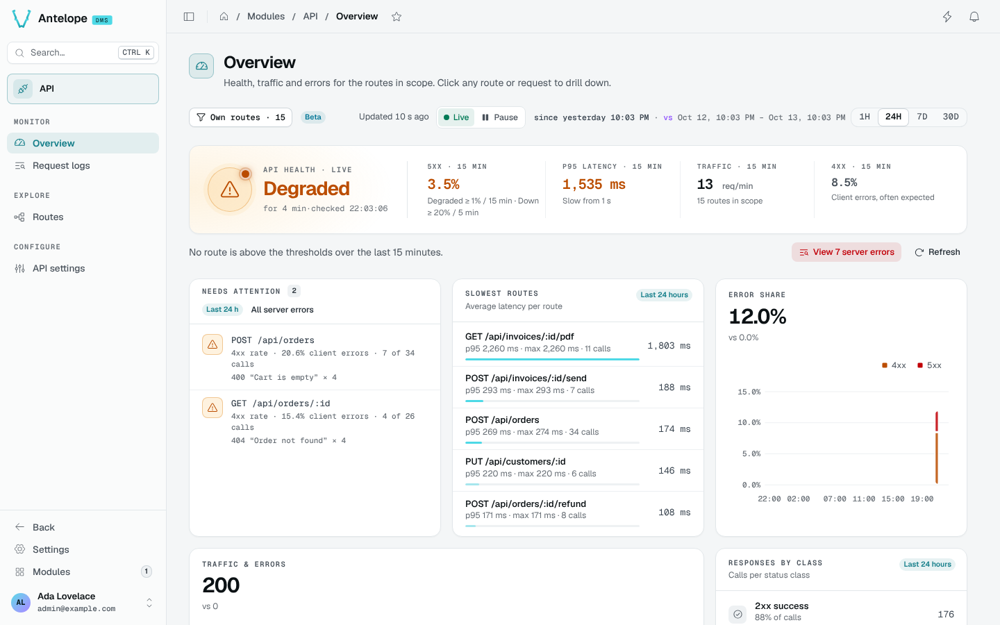

# Overview

The Overview (`/modules/api/overview`) answers one question first: is the API healthy, since when, and why not.

## Health verdict

The hero card shows the verdict (**Healthy**, **Degraded** or **Down**), how long it has held and when it was checked, next to the four signals it is computed from over the last 15 minutes: the 5xx rate, the p95 latency, the traffic in requests per minute and the 4xx rate. The API is **Degraded** from 1% of server errors over 15 minutes and **Down** from 20% over 5 minutes.

Under the hero, a sentence names the routes above the thresholds, and **View server errors** opens the [Request logs](/docs/modules/api/usage/request-logs) narrowed to them.

## Blocks

| Block | What it shows |
| --- | --- |
| Needs attention | Routes that are failing (5xx), slow (p95 at or above the slow threshold) or noisy (many 4xx), with their main error. |
| Slowest routes | Routes ranked by average latency, with p95, max and call count, and the average over the compared period. |
| Error share | The share of 4xx and 5xx over the period; the share over the compared period is a dashed line, and its value the "vs" figure. |
| Traffic & errors | Calls over time, with errors; the calls of the compared period are a dashed line, with the delta and the "vs" figure. |
| Responses by class | Calls per status class (2xx, 4xx, 5xx), each against its calls over the compared period. |

The health verdict and **Needs attention** judge the last 24 hours, whatever the period, and the recent requests and the activity are lists: none of them follows the comparison.

Every route and request is a link: a route opens in [Routes](/docs/modules/api/usage/routes), a request in a drawer on the right, and an incident opens the Request logs narrowed to its own range (`?since=&until=`).

## Period and scope

The Overview, Request logs and Routes open on the same DMS page toolbar, at the same size: the scope chip on the left, then how long ago the page was updated, **Live / Pause**, the period, the comparison and the presets.

The period selector (1H, 24H, 7D, 30D) sets what the blocks cover. On the Overview and Routes, the comparison menu (**vs previous period ▾**) sets what every chart and figure of the page compares with:

- **vs previous period**: the span of the same length right before (the default). Each chart draws the compared period as a dashed line over its own, each figure says its change and its value then ("+12 % vs. 1,020 previous period"; a rate in points);
- **No comparison**: the period alone, with no dashed line, no delta and no "vs" figure.

The menu offers only what the retention can show: the statistics behind 7D and 30D are kept 90 days at most, and the request logs behind 1H and 24H 30 days by default, so a year back is pruned and is not offered: a link asking for one, or for a comparison the page does not know, compares with nothing. A comparison reaching beyond the retention (the 30 days before a 30D period under a 30-day retention) compares with nothing rather than with zeros: the charts show the period alone, and Routes says there is no data to compare with. The Request logs list requests and compare nothing.

The period is kept in the URL (`?api.period=last-24h`), and the comparison with it (`?api.compare=none`); without them, a page opens on the last choice made on any of the three pages, else on the last 24 hours against the period before.

The scope chip (**Own routes · 15**) shows which routes the console watches. Change it on the [API settings](/docs/modules/api/usage/settings) page.

## Live mode

The Overview, Request logs and Routes share the DMS **Live / Pause** toggle (`L`):

- **Live** (the default): the page follows new requests as the DMS realtime channel announces them. Each block reads again at most every 5 s (Request logs), 10 s (Overview) or 15 s (Routes), every minute once a page shows a week or more, and on that clock while the realtime channel is down.
- **Paused**: nothing is read. The toggle says what was missed ("Paused · 40 new requests · 2 in 5xx"), the request tables keep their rows and offer "40 new requests · 2 in 5xx · Show". Resuming reads each block once.

The page also pauses by itself while its browser tab is hidden and while you type in the Tester. A request table holds its rows while one of them is open and says why ("Table on hold · search active"). The choice applies to all three pages; `?live=0` opens a page paused.
