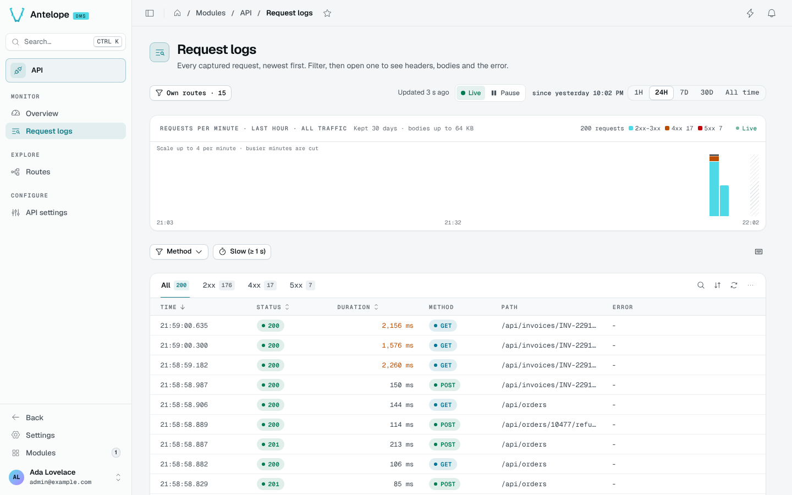
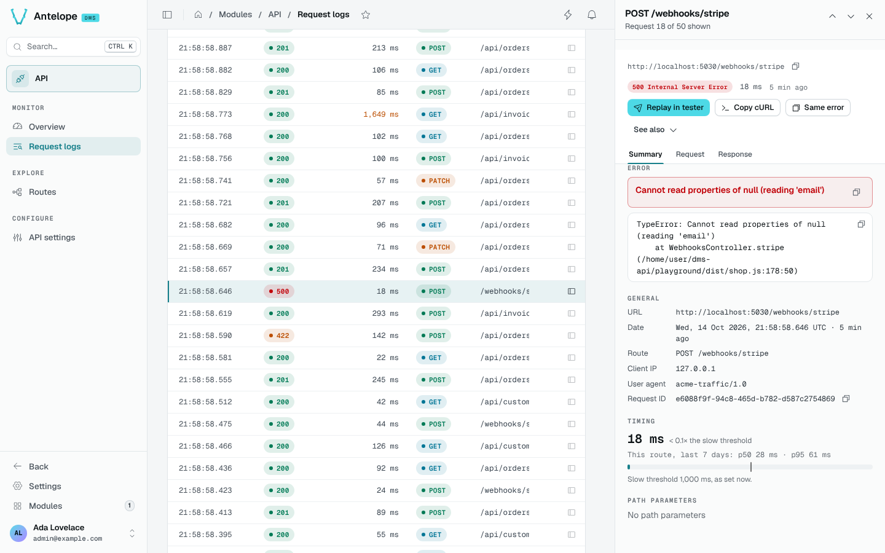

# Request logs

The Request logs page (`/modules/api/logs`) lists every captured request, newest first.

## Filter

- The chart at the top shows the requests of the period selected in the toolbar, by status class, for all traffic whatever the table filters, with the retention and body cap in use. Its bars keep between 50 and 120 of them: a minute over 1H, 15 minutes over 24H, 2 hours over 7D, 6 hours over 30D and **All time** (every request kept), and a length picked the same way for a custom range. A period that reaches now updates live and freezes on **Pause**; a past range is read once and says it is not live.
- The tabs filter by status class: **All**, **2xx**, **4xx**, **5xx**, with their counts.
- **Method** and **Slow (≥ 1 s)** narrow the table further; the slow filter follows your [slow threshold](/docs/modules/api/configuration).
- The period selector adds **All time** to 1H, 24H, 7D and 30D.
- `/` opens the search, and `?` lists the shortcuts.

## Open a request

A single click on a row opens the request in a side panel on the right. The panel is titled with its method and path; `J` and `K` step through the rows shown, and the URL names it (`?record=<id>`), so a link or a reload opens it again.

The panel has three tabs:

- **Summary**: the error and its stack, the general facts (URL, date, route, client IP, user agent, request ID), the timing compared with the route's p50 and p95, and the path parameters.
- **Request**: the captured headers, query string and body.
- **Response**: the status, headers and body.

From the panel, **Replay in tester** opens the route's Tester filled with the request, **Copy cURL** copies it as a command, and **Same error** lists the other requests that failed the same way.

::note
Bodies above the body cap are stored truncated and flagged, and secret-looking values are stored as `[REDACTED]`. See [Data handling](/docs/modules/api/configuration#data-handling).
::
