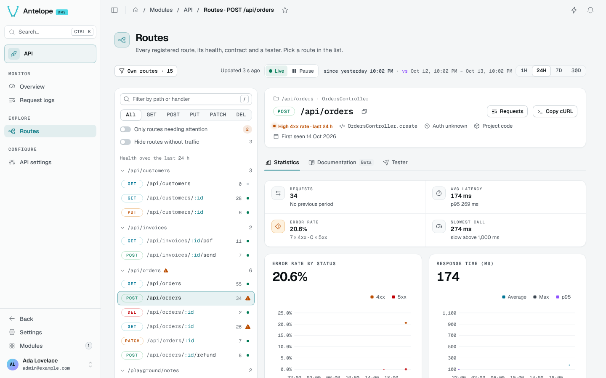
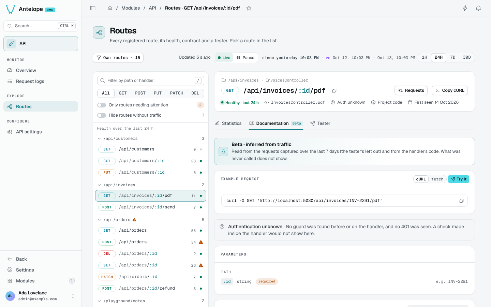
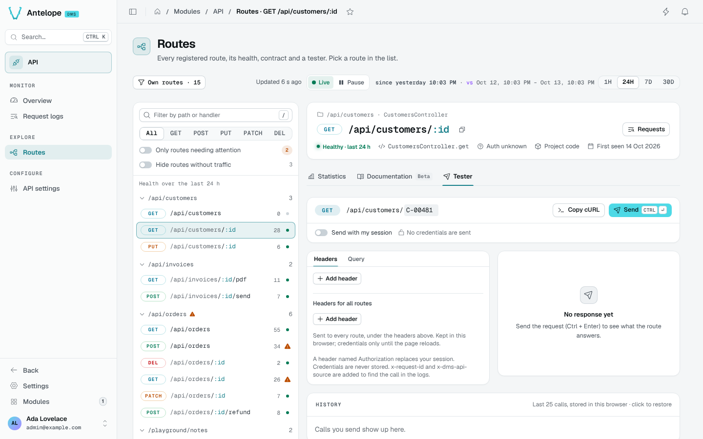

# Routes

The Routes page (`/modules/api/routes`) lists every route registered with the API provider on the left and opens one on the right. The URL names the route (`?route=POST%20%2Fapi%2Forders`) and the open tab (`?tab=tester`). Opened without a route, the page lands on the last route you opened in this browser session, else on the route needing attention first; the server picks it, so the page renders with it.

## Find a route

Routes are grouped by path prefix, with their call count and a health dot. Filter them by path or handler (`/`), by method, to **Only routes needing attention**, or **Hide routes without traffic**.

The route header shows its method and path, its controller and handler, whether it is authenticated, whether it comes from project or module code, and when it was first seen. **Requests** opens the Request logs on this route; **Copy cURL** copies an example call.

## Statistics

Requests, average latency and p95, error rate and slowest call for the period, then error rate by status and response time (average, max, p95) over time, the top errors and the recent calls.

Under the toolbar's comparison (**vs previous period**), each figure says its change and its value over the compared period, the error rate in points; the error rate chart draws the error rate of the compared period as a dashed line, the response time chart its average, with the delta; each top error says how often it occurred then. **No comparison** shows the period alone.

## Documentation

The contract of the route, inferred from its handler's code and from the requests captured over the last 7 days (Tester calls left out): an example request in cURL or fetch, its authentication, its path, query and body parameters with examples, and its responses. What was never called does not show.

::note
Authentication is detected from the guards and middlewares before the handler, using the `authMiddlewareNamePatterns` and `authMiddlewareCallbacks` [options](/docs/modules/api/configuration). A check made inside the handler does not show: the route reads **Auth unknown**.
::

## Tester

The Tester calls the route through the frontend server: fill the path parameters, headers, query and body, then **Send** (`Ctrl` `Enter`). **Copy cURL** copies the same call.

::warning
These are real requests, not simulations. A POST, PUT, PATCH or DELETE can change data or trigger external services. Start with a known read-only route and use test data for writes. Exclusion from monitoring statistics does not prevent side effects.
::

For a first call, select a read-only GET route from your project, fill its required parameters with an existing test record, and choose whether it needs **Send with my session**. Send the request and inspect the response before trying a write.

- **Send with my session** sends the call as you; off, no credentials are sent. A header named `Authorization` replaces your session.
- **Headers for all routes** are sent to every route and kept in this browser; credentials only until the page reloads.
- A request replayed from the Request logs restores what was captured. Redacted values, and the `Authorization`, `Cookie` and `X-Api-Key` headers, which are never captured, must be filled in by hand; a body cut at capture is replayed as text.
- The **History** keeps your last 25 calls in this browser; click one to restore it.
- `x-request-id` and `x-dms-api-source` are added so the call can be found in the logs. Tester calls are logged and marked, but left out of the statistics and the health.

::note
The module serves the Tester's forwarding route itself, `POST /api/_dms-api/tester`, from its `dms.server.ts`: the frontend server has no tester route of its own since `@antelopejs/dms-frontend` 0.6.
::
