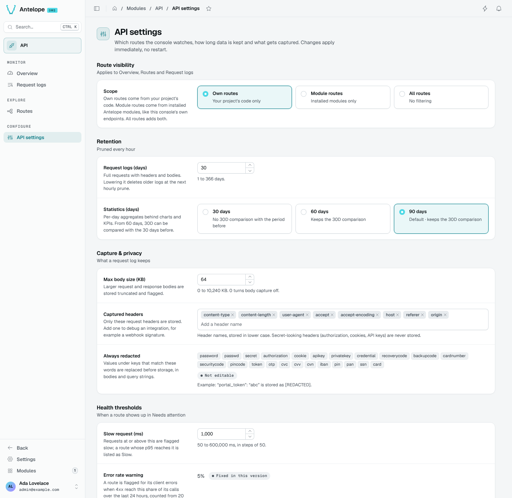

# API settings

The API settings page (`/modules/api/settings`) holds the console's runtime settings. Changes apply immediately, without a restart, and override the [module configuration](/docs/modules/api/configuration).

## Route visibility

**Scope** applies to the Overview, Routes and Request logs:

| Scope | Routes watched |
| --- | --- |
| Own routes | Your project's code only. |
| Module routes | Routes from installed modules. |
| All routes | Both project and installed-module routes. |

Scope does not turn internal traffic into application traffic: the console's monitoring endpoints and the DMS's own calls remain excluded. Tester calls are also excluded from statistics and health figures.

## Retention

Data is pruned every hour.

- **Request logs (days)**: full requests with headers and bodies, 1 to 366 days.
- **Statistics (days)**: per-day aggregates behind charts and KPIs, 30, 60 or 90 days. From 60 days, the 30D period can be compared with the 30 days before.

Lowering a retention shows how much the next hourly prune deletes and asks you to confirm it.

## Capture and privacy

- **Max body size (KB)**: larger request and response bodies are stored truncated and flagged. 0 turns body capture off.
- **Captured headers**: only these request headers are stored. Add one to debug an integration, such as a webhook signature. Secret-looking headers are never stored.
- **Always redacted**: values under keys that match these words are replaced before storage, in bodies and query strings. The list is fixed.

## Health thresholds

- **Slow request (ms)**: requests at or above it are flagged slow; a route whose p95 reaches it is listed as Slow.
- **Error rate warning** and **Down rate** are fixed in this version and shown for reference.

::tip
Each field shows its module default. **Use default** removes the override, so the field follows `antelope.config.ts` again.
::
